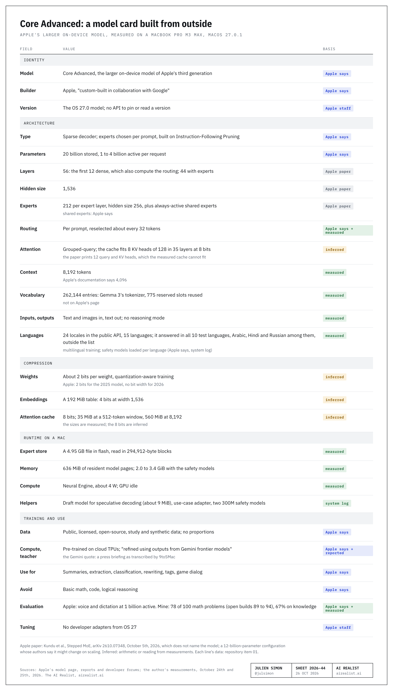
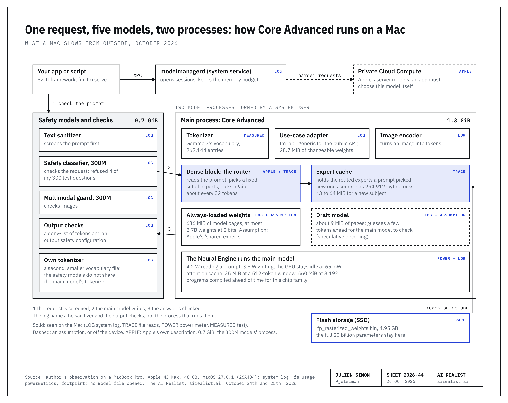
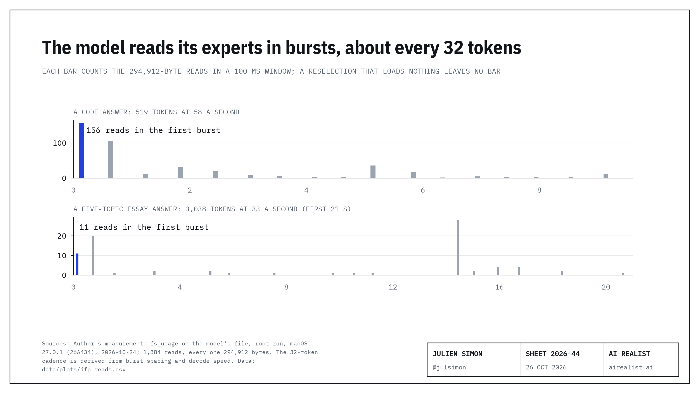
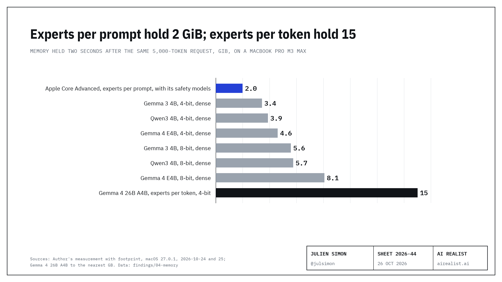
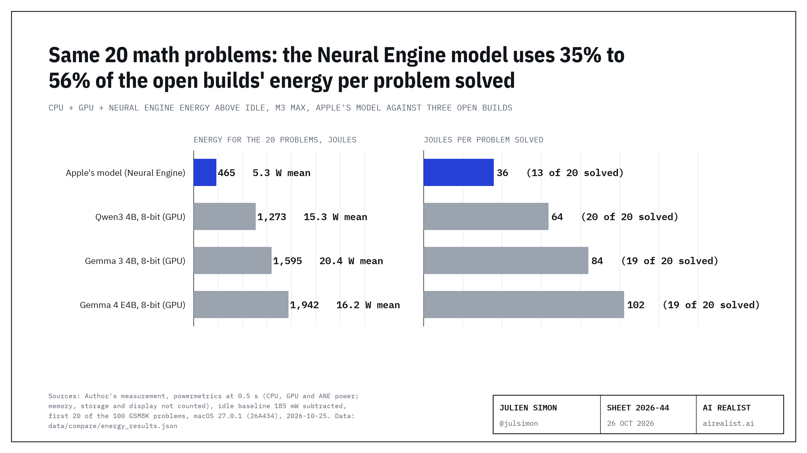
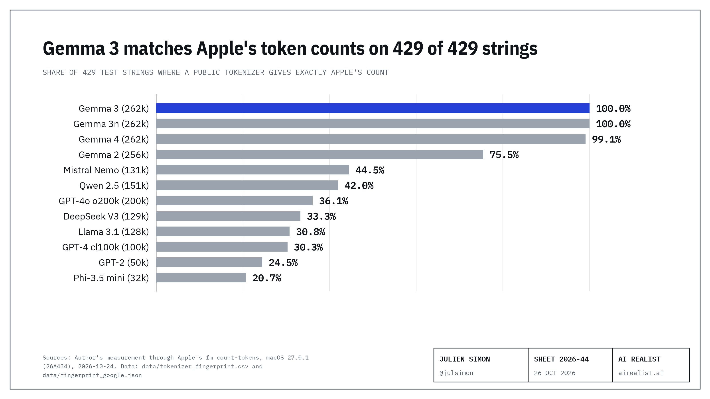
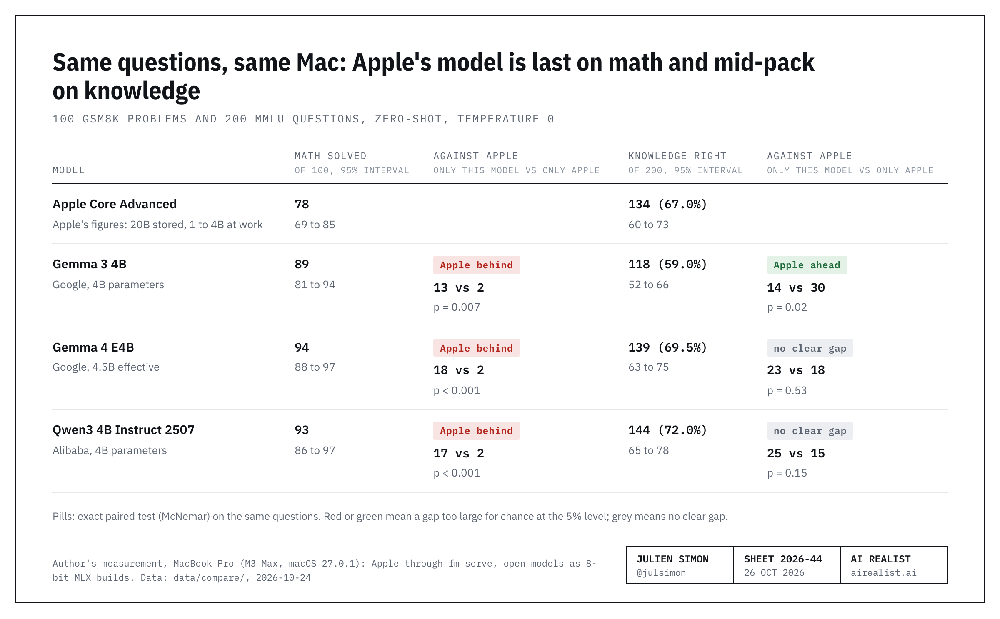

# apple-fm-mac

This repository holds the data, scripts and figures behind Julien Simon's AI Realist article on Apple's on-device language model on a Mac
(macOS 27, the `fm` command and the Foundation Models framework). Every measured number in the article traces to a data file or to the
report here, and most of the measurements can be rerun on your own Mac.

Everything was measured on one MacBook Pro (Apple M3 Max, 48 GB, macOS 27.0.1, build 26A434), on 2026-10-24 and 2026-10-25.

**Start with [`findings/INDEX.md`](findings/INDEX.md).** The article's notes cite these items by number. Each item has four parts:
the hypothesis (written before the test where one was; otherwise the question, marked as such), the experiment (method,
commands, files), the results, and the conclusion with what the finding does not show. The full write-up is
[`REPORT.md`](REPORT.md); [`MANIFEST.md`](MANIFEST.md) maps each number and figure of the article to its data file, its script
and its command.

## Headline results

`python3 scripts/check_numbers.py` recomputes every number below from the files in `data/` (no `fm`, no model, no network).
Apple's model is the larger on-device model, Core Advanced, as Apple's public API reports it on this Mac. The open models ran as 8-bit MLX builds with
thinking off: Google's Gemma 3 4B and Gemma 4 E4B, and Alibaba's Qwen3 4B Instruct 2507.

| Result | Apple's model | Open models and public tokenizers | Data file |
|---|---|---|---|
| Math: 100 GSM8K problems solved, zero-shot, temperature 0 | 78 | Gemma 3 89, Gemma 4 94, Qwen3 93 | `data/card_inputs/evals.json`, `data/compare/results_*.json` |
| Knowledge: 200 MMLU questions right | 134 (67.0%) | Gemma 3 118 (59.0%), Gemma 4 139 (69.5%), Qwen3 144 (72.0%) | same |
| Questions only one of the pair got right, open model against Apple (exact McNemar p) | | math 13 to 2 (p = 0.007), 18 to 2 (p = 0.0004), 17 to 2 (p = 0.0007); knowledge 14 to 30 (p = 0.023), 23 to 18 (p = 0.53), 25 to 15 (p = 0.15) | same |
| MMLU read from the final answer, after the eight replies cut at 8 tokens were rerun | | Qwen3 150 (75.0%), 28 to 12, p = 0.017; Gemma 4 140 (70.0%), 24 to 18, p = 0.44 | `data/compare/mmlu_uncapped.json` |
| Guardrail refusals, counted wrong | 4 of 300 (1 math, 3 knowledge) | none | `data/card_inputs/evals.json` |
| Writing speed on the math problems, prefill included | 50.5 tokens/s | behind `mlx_lm.server`, called by the same client code: Gemma 3 63.0, Gemma 4 51.6, Qwen3 65.4; in process, in the first run: 72.9, 59.3, 73.7 (each in its own tokens) | `data/card_inputs/evals.json`, `data/compare/server_rerun_*.json`, `data/compare/results_*.json` |
| Knowledge date, 7 events from February to June 2025, forced to guess (scored one by one) | 1 right | 0 right for each | `data/compare/dated_handscored.json` |
| Memory held, by `footprint`, two seconds after a 5,000-token request | 1.3 GiB for the model (293 MiB process footprint plus 1,068 MiB of neural-owned memory outside it), 2.0 GiB with the second process that runs the safety models (140 plus 535 MiB) | the open builds' `mlx_lm.server` processes: 3.4 to 4.6 GiB at 4 bits, 5.6 to 8.1 GiB at 8 bits; at idle 2.6 to 8.0 GiB (Apple's two processes: 2.8); largest reading during the request 4.4 to 9.4 GiB (Apple, one snapshot: 3.4) | `data/plots/footprint_categories.csv`, `data/compare/memory_protocol.json` |
| Power, `powermetrics` at 250 ms | Neural Engine 4.2 W in prefill, 3.8 W in decode; GPU 65 mW | not measured | `data/plots/power_samples.csv` |
| Context window | 8,192 tokens (8,102 worked, 8,158 failed) | | `data/plots/context_limit_probe.csv` |
| Prefill and first words | about 1,100 tokens/s at 1,000 to 3,000 tokens; first streamed chunk at 0.6 s for a 309-token prose reply | | `data/plots/prefill_early.csv`, `data/bench-2026-10-24.json` |
| Speed against prompt length | first token 0.5 s at 20 tokens, 9.5 s at 6,881; writing 72 tokens/s at 20 tokens, 36 at 4,921 | | `data/plots/ctx_profile.csv` |
| No prefix cache in `fm serve` | the same 2,024-token prompt: 2.01 s, then 1.41 s three times | | `data/plots/api_cache_tests.csv` |
| Memory contention | 201 GB/s of CPU copy traffic: writing 9.1% slower, 2,000-token prefill 21.7% slower; a load with no memory traffic: within noise | | `data/plots/contention.csv` |
| Expert reads from flash, `fs_usage` | 1,384 reads, each exactly 294,912 bytes, from a 4,948,197,376-byte file; 152 to 228 blocks (43 to 64 MiB) in the first burst of each of the first four prompts | | `data/plots/ifp_reads.csv`, `data/plots/parameter_budget.csv` |
| Model pages that stay loaded | 636 MiB (40,680 pages of 16 KiB), at most 2.7 billion weights at 2 bits per weight | | `data/plots/parameter_budget.csv` |
| Long-context retrieval | 36 of 36, prompts of 912 to 6,996 tokens | not run | `data/card_inputs/needle.json` |
| Token counts equal to Apple's `fm count-tokens`, 429 strings | | Gemma 3 429, Gemma 3n 429, Gemma 4 425, Gemma 2 324 (75.5%); eight tokenizers from other labs 20.7% to 44.5% | `data/tokenizer_test/counts_all_429.csv` |
| Google's countTokens endpoint, 257 public strings, four model names | | Apple's count on 257 of 257 for each name | `data/gemini_counttokens.json` |

Behind a local `mlx_lm.server` and called by the same client code as Apple's model, no open build moved by more than 1 from its
in-process counts (Gemma 3 89 and 118, Gemma 4 93 and 140, Qwen3 93 and 144; `data/compare/server_rerun_*.json`).

## Figures

The figures of the article, in its order. Each footer names its source.















In this repository only: storage and memory (`plots/cost-mac.png`, item 04), time to first token and writing speed
(`plots/speed-context.png`, item 10), and six public descriptions of Google's role (`plots/six-sentences.png`, item 07).

## Rerun the measurements

You need macOS 27 on an Apple silicon Mac with Apple Intelligence on, which provides `fm`; Python 3.10 or later and
[`uv`](https://docs.astral.sh/uv/); Xcode or its command line tools for `swiftc` and `cc`. The open-model runs download 2 to 9 GB
per build from the Hugging Face Hub, and the tokenizer test downloads each tokenizer file once. Run every command from the
repository root. Scripts sit next to the data they wrote, at the paths the article and `REPORT.md` cite, and a rerun replaces that
file: in a git clone, `git diff data/` shows how your numbers differ. Build products and root-script output go to ignored folders
(see `.gitignore`).

| Claim | Command |
|---|---|
| Apple's side of the same questions (GSM8K and MMLU through `fm serve`) | `fm serve --host 127.0.0.1 --port 18976` in another terminal, then `uv run --with pandas --with pyarrow --with huggingface_hub python data/card_inputs/evals.py` and `python3 data/card_inputs/evals_report.py` |
| The three open models, in process with MLX (also runs the dated events) | `zsh data/compare/run_all.sh`, or one model: `uv run --no-project --with mlx-lm --with pandas --with pyarrow --with huggingface_hub python data/compare/compare_models.py mlx-community/gemma-3-4b-it-8bit gemma3-4b-8bit` |
| The same questions behind a local server | `bash data/compare/run_server_checks.sh` (its first loop is the earlier memory readings) |
| Memory by `footprint` of the six open builds at Apple's three moments | `bash data/compare/run_memory_protocol.sh` |
| Apple's answers to the dated events | with `fm serve` on port 18976: `python3 data/compare/dated_events_apple.py` |
| The eight MMLU replies rerun without the 8-token cap | `uv run --no-project --with mlx-lm --with pandas --with pyarrow --with huggingface_hub python data/compare/mmlu_uncapped.py` |
| The three GSM8K answers that parsed as 0, asked again | `fm serve --port 18977`, then `uv run --with pandas --with pyarrow --with huggingface_hub python data/compare/recheck_gsm.py` |
| Paired counts, exact p-values and every headline number | `python3 data/compare/paired.py`; `python3 scripts/check_numbers.py` |
| Memory of the open builds by MLX's own counters | `uv run --no-project --with mlx-lm python data/compare/memory_open_models.py` |
| The tokenizer test on the 257 public strings, or on your own strings | `uv run --with tokenizers --with tiktoken python scripts/tokenizer_test.py data/tokenizer_test/strings_public.csv` (add `--reuse-apple` to skip `fm`); your strings: `uv run --with tokenizers --with tiktoken python scripts/tokenizer_test.py my_strings.txt` (one string per line, or a CSV with a `text` column) |
| Google's counter on the same 257 strings | `GEMINI_API_KEY=<your key> python3 data/gemini_counttokens.py` |
| What the public API reports (variant, context size, capabilities, languages) | `mkdir -p runs && swiftc -O -parse-as-library data/public_api_query.swift -o runs/public_api_query && runs/public_api_query` |
| `fm serve` parameters, token limits and caching | with `fm serve` on port 18976: `python3 data/api2.py`, `python3 data/api.py`; the token limits alone: `python3 data/compare/probe_max_tokens.py` (starts its own server) |
| Prefill, decode and determinism; speed against prompt length | `python3 data/bench.py`; `python3 data/profile_ctx.py` |
| Long-context retrieval, chat-template accounting, sampling | with `fm serve` on port 18976: `python3 data/card_inputs/needle_test.py`, `python3 data/card_inputs/template_probe.py`, `python3 data/card_inputs/seed_repeat.py` |
| Memory contention | `cc -O2 -o data/membw data/membw.c && python3 data/contention.py` |
| How fast the Neural Engine streams weights (public Core ML) | `uv run --python 3.12 --with coremltools --with numpy python data/ane_bw.py fp16` |
| Image token cost and the image tests | `bash data/make_square_images.sh`, `swiftc data/make_test_images.swift -o runs/make_test_images && runs/make_test_images data/img`, then `swiftc -O -parse-as-library data/image_tokens.swift -o runs/image_tokens && runs/image_tokens none data/img/i64.png data/img/i1024.png` |
| Speculative-decoding probes | `mkdir -p data/swiftq && swiftc -O -parse-as-library data/stream_snapshots.swift -o data/swiftq/stream && python3 data/spec_probe.py` |
| Energy for the same 20 math problems, 8-bit and 4-bit sets, and the independent recomputation (root for the runs) | `sudo bash data/compare/run_energy.sh`; `sudo ENERGY_TAG=_4bit bash data/compare/run_energy.sh`; `python3 scripts/energy_recheck.py [_4bit]` |
| The third expert-read trace and its token positions (root for the trace) | `sudo bash data/compare/inspect_ifp_cadence.sh`; `python3 data/compare/longctx_stream.py` |
| Power, memory maps, KV-cache steps, expert reads, pool lifetime (root, optional) | `sudo bash data/inspect_fm.sh`, `sudo bash data/inspect_maps.sh`, `sudo bash data/inspect_scale.sh`, `sudo bash data/inspect_ifp.sh`, `sudo bash data/inspect_pool.sh` |
| The figures | `uv run --with matplotlib --with numpy python scripts/charts/make_charts_mac.py` and the same with `scripts/charts/make_charts.py`; tables: `python3 scripts/charts/make_table_spec.py`, then `uv run --with playwright python scripts/charts/table.py data/tables.json plots/` |

The original 429-string scripts (`data/card_inputs/apple_counts.py`, `fingerprint.py`, `fingerprint_google.py`,
`fingerprint_google_diff.py`, `build_corpus.py`) are kept as run, with paths fixed, but they need `corpus.json`, which is not
public (see below). `scripts/tokenizer_test.py` is the same test for any strings.

## Terms and limits

- **No reverse engineering.** Apple's macOS license, section N, bars decompiling, reverse engineering or disassembling Apple's
  software. Nothing here does any of that: no model file or compiled program was opened, read or disassembled, and no
  process memory was dumped. The measurements watch the Mac from outside, with macOS's own tools and Apple's public interfaces.
- Read `fm license --show` before you run anything here. Its notice binds you to the macOS software license and says that you
  agree "TO NOT PROGRAMMATICALLY ACCESS OR USE APPLE MODELS THROUGH APPLE SOFTWARE OR SERVICES EXCEPT AS EXPRESSLY PERMITTED".
  Decide for yourself what it permits; this repository is not legal advice.
- Apple's models, their weights and Apple's software belong to Apple. Nothing here contains or reconstructs them.
- This repository observes from outside: system-call names, file descriptors, offsets and sizes (`fs_usage`), memory-region
  layout and counters (`vmmap`, `footprint`), power counters (`powermetrics`), the unified log, and Apple's public interfaces
  (`fm`, `fm serve`, the Foundation Models Swift API). No weight file was read, nothing was disassembled, no process memory was
  dumped or sampled, and System Integrity Protection was not changed. Symbol work means exported names only (`dyld_info -exports`),
  and the symbol listings are not in this repository.
- `data/card_inputs/template_probe.py` includes five prompts that ask the model to repeat the text that comes before the user message; the model did not reveal it (`REPORT.md` 28.2). Read the script before you run it.
- The five root scripts (`data/inspect_*.sh`) are optional. They are read-only observation scripts, they need `sudo`, and you
  should read each one before you run it.

## Measured once, on one Mac

One MacBook Pro: Apple M3 Max (12 performance and 4 efficiency cores, 40-core GPU, 16-core Neural Engine), 48 GB of memory,
macOS 27.0.1 (build 26A434), 2026-10-24 and 2026-10-25, on battery for the energy runs. Each result is a single run unless its file says otherwise (speed against prompt length
has two runs per length). The samples are small: 100 math problems, 200 knowledge questions, 28 dated events, 36 retrieval
prompts. On this Mac the public API reported Core Advanced with an 8,192-token window. A Mac with less memory, another
chip or another OS build can get another model or behave differently, and Apple changes the model with OS updates without a way
to pin a version.

## Out of scope

- Core, the 3-billion-parameter on-device model, and every device other than this Mac: no iPhone, iPad, 16 GB Mac or
  other OS build was measured.
- Private Cloud Compute and Apple's server models.
- Apple's Python SDK (`apple_fm_sdk`): not installed.
- Fine-tuning: Apple dropped adapters for the OS 27 model; nothing here tests tuning.
- Weights, compiled programs and asset files: not read. Architecture is inferred only from sizes, counters, logs and Apple's
  pages.
- Whose weights are inside: equal token counts show the same vocabulary in practice, not where the weights came from.
- Quality beyond the questions listed above.

## Layout

```
README.md  MANIFEST.md  REPORT.md  LICENSE  LICENSE-DATA.md  CITATION.cff
findings/              one folder per finding, 01 to 16 in the article's order, each with a README (start at findings/INDEX.md)
plots/                 the six figures of the article (PNG)
data/                  measurements, each script next to the data it wrote (the paths the article and REPORT.md cite)
  compare/             same questions through the open models, dated events, memory by footprint, local-server rerun
  card_inputs/         Apple's same-questions run, tokenizer probes, retrieval and chat-template probes
  tokenizer_test/      the 257 public test strings with every count; the counts of all 429 strings without text
  plots/               every measured series as CSV, with a README of columns and caveats
  *_2026-10-24/        the kept parts of the raw root runs
scripts/               written for this repository: check_numbers.py, energy_recheck.py, tokenizer_test.py, charts/ (figure code and fonts)
```

## Left out, and why

- The exported symbol listings and the report sections built on them (REPORT sections 3, 24 and 25): internal names beyond
  what the results need. `data/plots/catalog_models.csv` keeps the three base-model names that other sections use.
- Raw `fs_usage` traces, process snapshots, memory-region maps, the entitlement listing, the asset listing and the unified-log
  capture: they name files inside Apple's protected asset folder, asset hashes and provider processes, and some carry paths of
  the test Mac. The numbers they gave are in `data/plots/`.
- 172 of the 429 tokenizer test strings (110 English sentences sampled from the author's research corpus, 60 sentences of the
  full report, and 2 strings with the author's name): their counts are in `data/tokenizer_test/counts_all_429.csv`, without
  their text. The 257 strings that were sent to
  Google's counter are public, in `data/tokenizer_test/strings_public.csv`.
- The text of Apple's 2025 technical report: on [arXiv](https://arxiv.org/abs/2507.13575).
- The test images made from an Apple icon: `data/make_square_images.sh` rebuilds them byte for byte.
- Logs that print paths of the test Mac, and the model card with its repository-style files.

## License and citation

Code: MIT ([`LICENSE`](LICENSE)). Text, data and figures: CC BY 4.0 ([`LICENSE-DATA.md`](LICENSE-DATA.md)).
To cite: [`CITATION.cff`](CITATION.cff).
